# Changelog

All notable changes. The newest is first. Versions are `MAJOR.MINOR.COMMITS` (see `scripts/version.sh`).

Every entry that changes what you can see carries a screenshot or an animation (pictures live in
`site/assets/`; the website strips the `site/` prefix).

## 0.1

### Scenery overlay preview

- Load enabled overlay DSFs above the base mesh, including package-local objects,
  facades and draped polygons. [UHWW preview](site/assets/uhww-overlay-preview.jpg)
  shows the installed aerial-photo overlay. Exclusions, ownership filters and
  complete layering are still missing. To fit large scenes in GPU memory, color
  textures are resized to at most 1024 pixels by default; set
  `OPENXPLANE_TEXTURE_MAX_SIZE` to change this preview limit.

### Custom base-mesh selection

- Enabled custom scenery base meshes now take priority over global tiles; DSF
  overlays and disabled packs are excluded from the base-mesh choice. Package-local
  terrain definitions resolve before library exports. Overlay composition remains
  unimplemented. The [UHWW preview](site/assets/uhww-base-selection.jpg) shows the
  installed global base because the installed UHWW Ortho tile is an overlay.

### Terrain shader research

- Recovered and tested original mode5 composite uniform-prefix packing, including
  reciprocal projection and sign changes. Added a port helper for explicit inputs;
  renderer integration and live GPU comparison remain unfinished.
- Confirmed composite parameter order in the direct TER-loader branch as well
  as the common reader; added explicit seventh-value regression coverage.
  GPU uniform upload remains unverified.
- TER loading now retains composite texture/noise paths, projection and numeric
  parameters. Read3597 installed terrain definitions, including1213 composite
  declarations, and checked resource paths. Rendering still reports compositing
  as unsupported; no visual change is claimed.
- Compared an isolated78-instruction composite arithmetic region with a separate
  formula on256 synthetic cases. Added a limited CPU probe with explicit sample
  substitutions; GPU output and live material values remain unverified.
- Added image-sample provenance and exact-member selection to the SPIR-V
  inspector. Candidate1202 exposes four noise samples and distinct composite
  coordinates; arithmetic execution and live color parity remain unverified.
- Checked original projection-field updates and native variant validation.
  Composite borders use digit2; rejected combinations and archive lookups narrow
  composite-color candidates to the relevant declared modes. Live selection and
  renderer integration remain unfinished.
- Identified DETAIL as texture mode9 and corrected the interpretation of shader
  candidate493. Checked original reciprocal-scale arithmetic; COMPOSITE_TEX has
  a separate loader branch and still needs final-mode tracing.
- Located material-to-variant preparation and checked180 controlled states
  against original instructions. Texture, border and projection digits now have
  recorded input offsets; original TER loading and live draw selection remain
  unresolved.
- Recovered variant slot arithmetic and matched1128 controlled states against
  the original machine code. The extra factor of four is explained; candidate493
  now maps to explicit terrain parameter digits. Live material selection remains
  unverified and the renderer is unchanged.
- Removed the base-constructor stub from terrain registration research and
  checked its original inline stage vector. Located the manager call; variant
  index encoding and rendered output remain unchanged.
- Added a build-checked emulation probe for original terrain registration,
  recording parameter ranges and disclosed stubs. Slot encoding remains
  unresolved; this research does not change the rendered image.
- Traversed complete serialized XSV variants and linked candidate493 to two
  mapping slots. All95 installed mapping files were structurally consumed;
  this does not establish active scene selection or shader equivalence.
- Extended XSV inspection through serialized resource layouts using original
  reader evidence. Added bounds and name-reference tests; active variant and
  backend-dependent resource remapping remain unresolved.
- Recovered the XSV6 mapping prefix through REA and added a bounded inspector
  with malformed-input tests. Corrected the signature description; runtime
  variant selection remains unresolved.
- Added a bounded SPIR-V archive inspector and recorded REA evidence for the
  installed terrain shader archive. Candidate resource usage exposes unresolved
  variant and border-channel handling; composite color blending is still not
  implemented. [Findings and next probes](research/TERRAIN_SHADER_ARCHIVE.md).

### Terrain border masks

- Source terrain now applies grayscale BORDER_TEX masks using DSF border ST,
  including COMPOSITE_BORDERS discard before NO_ALPHA. KSEA uses67 masked overlay
  groups. Color compositing, original depth/material rules and paired visual
  validation remain unfinished. [Evidence and limits](research/TERRAIN_BORDERS.md).
  

### Texture minification

- Scene textures now receive GPU-generated mip chains and trilinear minification,
  reducing the fine-grained noise in distant KSEA terrain. Controlled captures
  use the same mesh/camera with mipmaps off/on. Native filtering, source DDS mip
  preservation, alpha coverage and missing terrain mask/composite shaders remain
  unfinished. [Evidence and limitations](research/TEXTURE_FILTERING.md).
  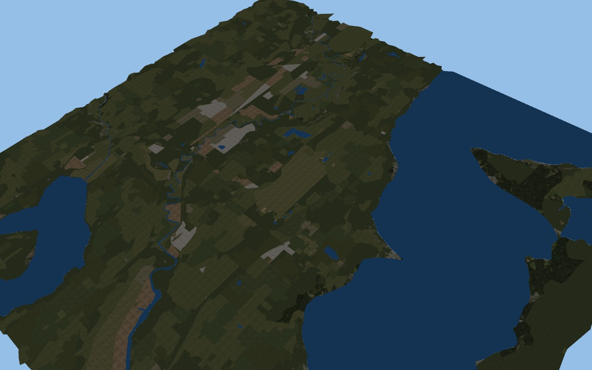

### POL holes and Bezier contours

- Airport POL loading now preserves holes and samples curved geometry and ST
  controls. KSEA builds797 polygons in20 batches; one contour still fails area
  validation. Native adaptive tessellation and exact material/layer handling
  remain unfinished. [Evidence and limitations](research/DRAPED_POLYGONS.md#holes-and-curved-contours).
  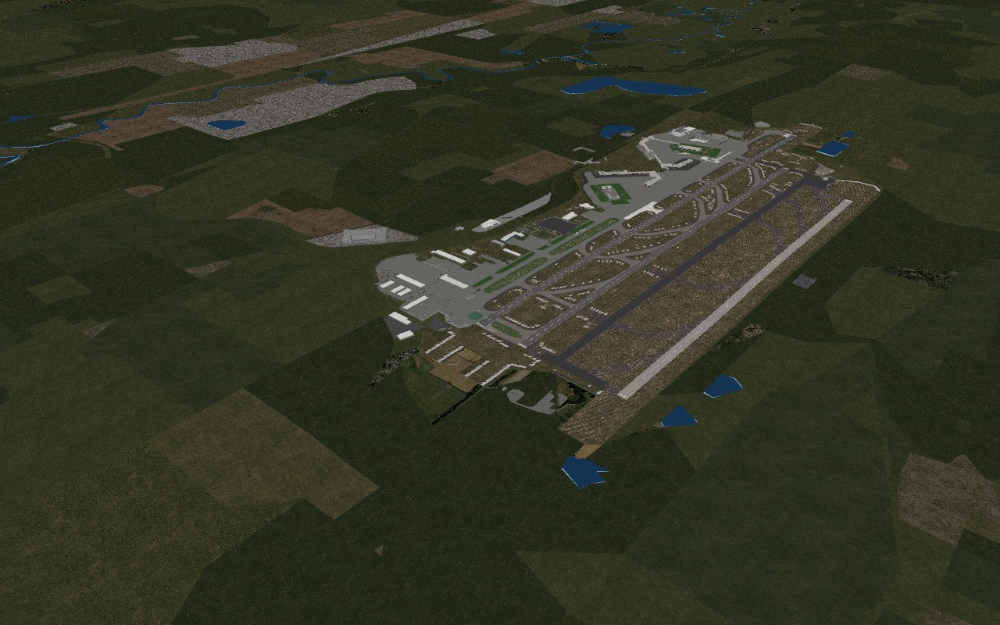

### Installed draped polygon textures

- Airport scenes now load straight single-contour POL pavement and ground-sign
  textures from installed libraries, including AEP exports. KSEA builds752
  polygons in16 batches; holes, curves, exact layer/material handling and POL
  surface physics remain unfinished.
  [Evidence and limits](research/DRAPED_POLYGONS.md).
  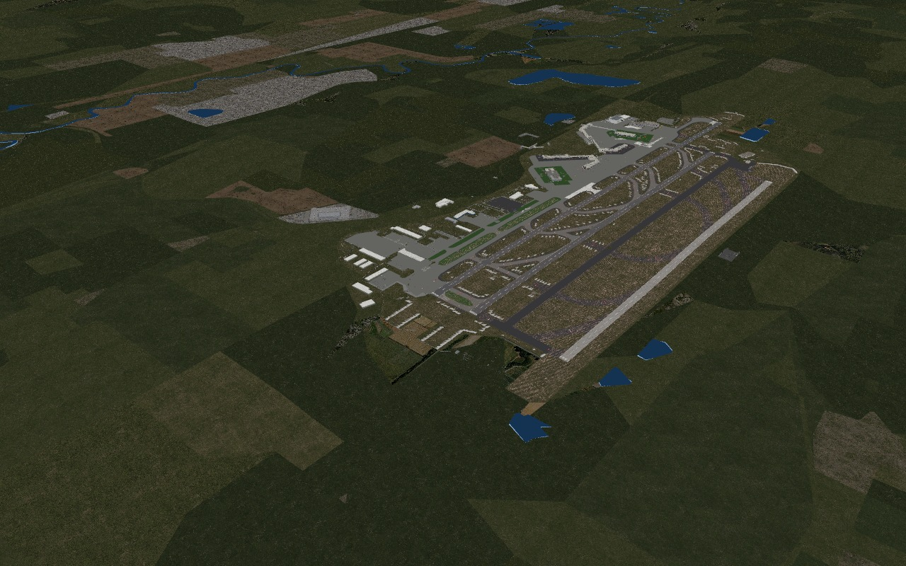

### Source terrain in the flight scene

- Airport and flight scenes now share source DSF terrain and TER base textures,
  without the central slab when loading succeeds. Airport surfaces, nearby objects
  and supported facades follow physical terrain height; wheels query the same
  source/runway/pavement surfaces. KSEA's corrected5s GPU run reaches11.8kt.
  Draping offsets, contact forces, materials and missing-coverage fallback remain
  approximate. [Evidence and limitations](research/LIVE_TERRAIN.md).
  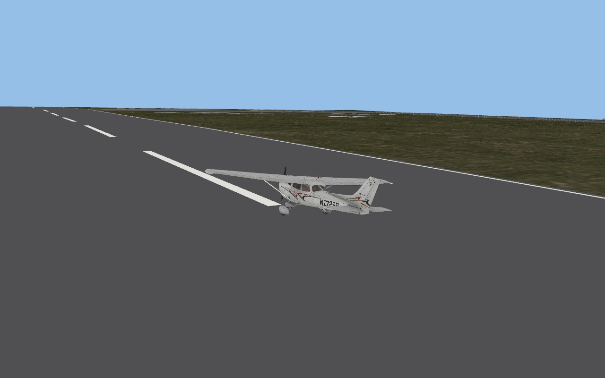

### Terrain base materials and seasonal exports

- Source mesh inspection now loads installed TER base textures, explicit/projected
  UVs, repeat/nowrap and NO_ALPHA. Added explicit seasonal library exports so the
  summer KSEA inspection resolves77 textured materials. Border/composite shaders,
  climate selection, water effects and live airport terrain integration remain
  unfinished. [Evidence and limitations](research/TERRAIN_MATERIALS.md).
  

### Source terrain mesh inspection

- Added terrain patch/list/strip/fan decoding and `mesh-render` against installed
  compressed DSF tiles. KSEA's inspection shows39303 source triangles, including
  coastlines and inland water. It uses diagnostic colors; playable airport scenes
  still use the previous raster/slab preview pending materials and collision.
  [Evidence and remaining integration](research/DSF_MESH.md).
  

### Installed facade roofs

- KSEA facade previews now draw ROOF_HEIGHT layers with the declared roof base
  texture and repeating ROOF_SCALE mapping. The installed scene reports67 roofed
  footprints. Curves, corner miters, roof attachments, terrain alignment and
  native visual parity remain unfinished.
  [Evidence and limitations](research/FACADE_ROOFS.md).
  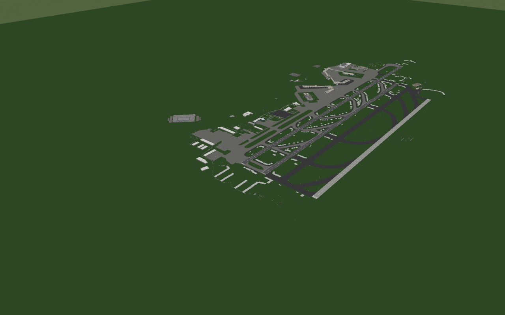

### Installed facade walls

- Airport scenes now place straight type-2 FAC wall meshes along supported DSF
  contours, using installed textures and explicit wall choices. KSEA builds
  88 footprints in 22 batches. Roofs, curved walls, corner miters and attached
  objects remain missing; deterministic fits and flat ground are approximations.
  [Evidence and native investigation](research/FACADE_WALLS.md).
  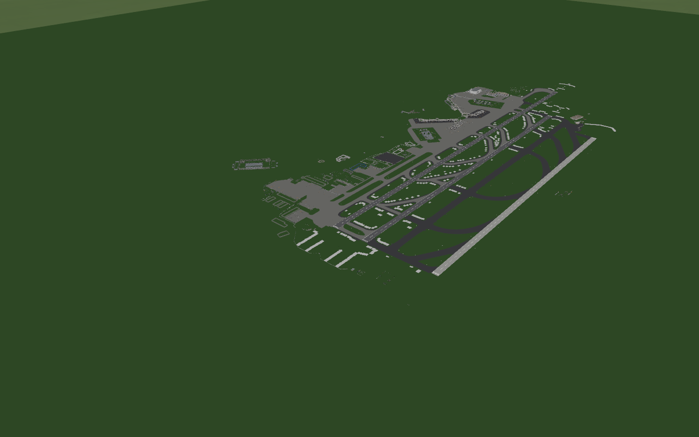

### Type-2 facade mesh inspection

- Added typed FAC floor/segment/mesh/wall/spelling loading and `fac-render` to
  inspect original mesh coordinates and base textures. A KSEA terminal segment
  now renders directly from its installed FAC; airport wall fitting, roofs,
  attachments and original materials remain unfinished.
  [Evidence and next work](research/FACADE_MESHES.md).
  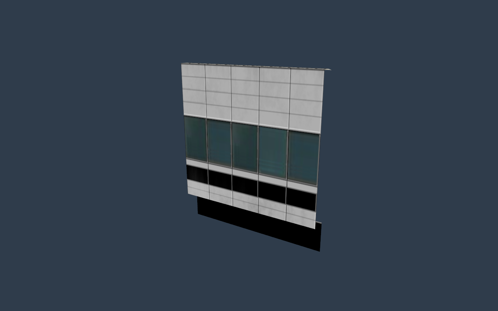

### DSF polygon inspection

- Retained DSF polygon contours, parameters and all coordinate planes instead
  of skipping polygon commands. `dsf-info <tile.dsf>` reports resource groups;
  the installed Global Airports +47-123 tile decodes 6474 polygons and 13168
  objects. Facade geometry is still missing from the renderer.
  [Evidence and next work](research/DSF_POLYGONS.md).

### Geographic scenery library selection

- Airport library lookup now evaluates REGION_RECT, REGION_ALL and REGION_BITMAP
  against the airport's DSF cell, preserving fallback exports outside a region.
  REGION_DREF conditions remain unsupported and are excluded from the preview;
  season/random selection and per-tile boundary handling remain unfinished.
  [Evidence and limits](research/LIBRARY_PRECEDENCE.md#geographic-dsf-lookup).
  

### Scenery library export selection

- Corrected preview resource selection so BACKUP yields to ordinary exports,
  EXTEND retains lower-package candidates and EXCLUDE blocks later definitions.
  Sibling variants are retained; the renderer still picks the first one.
  Region/season/dataref conditions and random/weighted selection remain unfinished.
  Repeated scenery now shares geometry through GPU instances: corrected resource
  selection had exposed a 4.78GB expanded-buffer failure at KSEA.
  [Evidence and limits](research/LIBRARY_PRECEDENCE.md).
  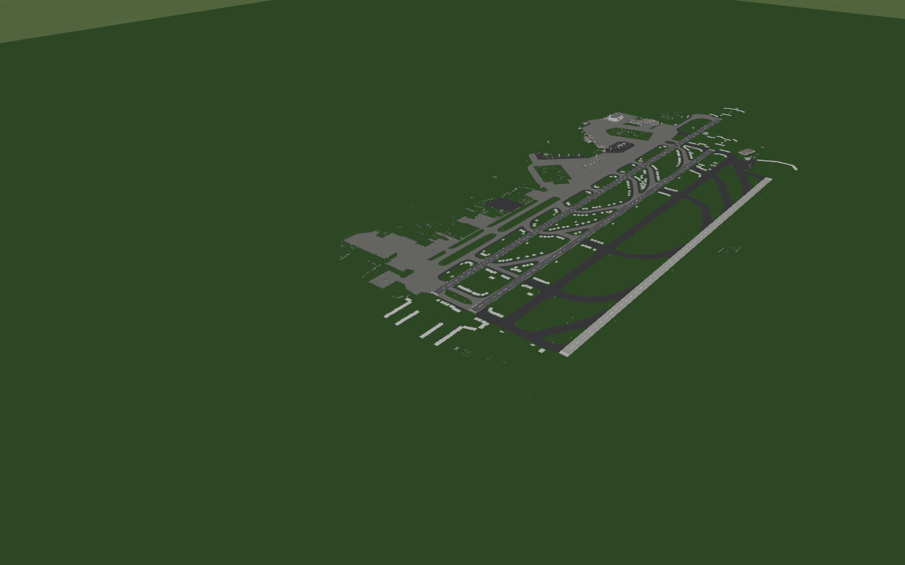

### Autogen point object groups

- Airport scenes now expand object annotations in installed AG_POINT packages,
  including anchor, scale, rotation and delta height. KSEA expands 192 groups,
  bringing the preview to 4107 nearby instances. First-tile/full-density/flat-ground
  policies remain approximations; tile surfaces, facades and vegetation are not
  drawn. [Evidence and limits](research/DSF_OBJECTS.md#ag_point-object-annotations).
  

### Installed airport objects

- Airport scenes now instantiate nearby OBJ8 placements from the original
  Global Airports DSF and resolve installed library resources. The KSEA preview
  renders 2370 instances; AGP, facades, custom overlays, correct terrain placement
  and complete materials remain unfinished. This is not verified visual parity
  or complete mod compatibility. [Evidence and limits](research/DSF_OBJECTS.md).
  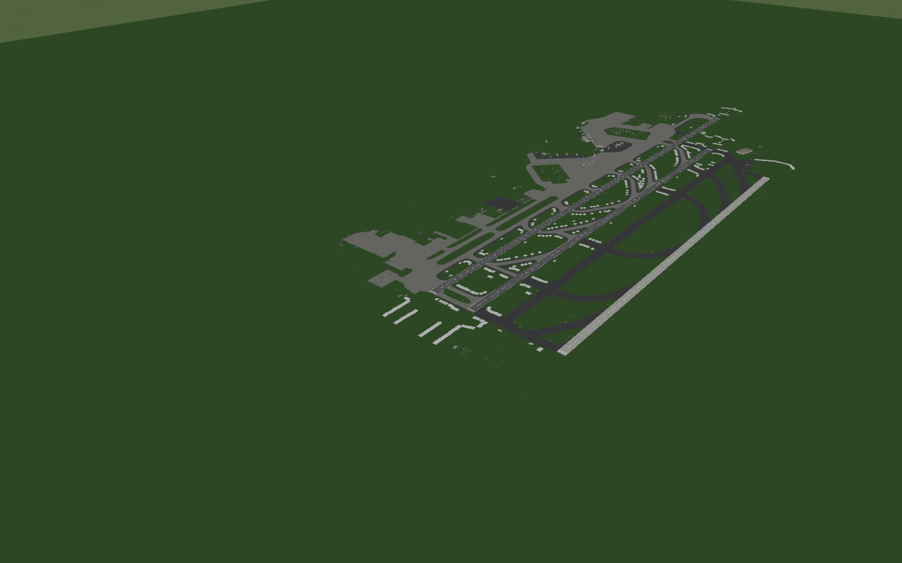

### Main website and documentation

- Added a separate presentation homepage with aircraft imagery, project overview,
  downloads and live compatibility estimates. The previous documentation interface
  now lives at `/docs/`; earlier hash routes redirect there. Desktop and390px mobile
  navigation, docs loading, gallery images and JavaScript errors were checked in Chrome.
  

### Installed DSF terrain

- Airport scenes now read available compressed global DSF elevation rasters in
  place and render peripheral terrain. This remains a coarse solid-color preview:
  the central flat airport slab, missing objects/materials and flat collisions
  are unresolved. `terrain-render` exports an overview for inspection.
  [Coverage and next work](research/DSF_TERRAIN.md).
  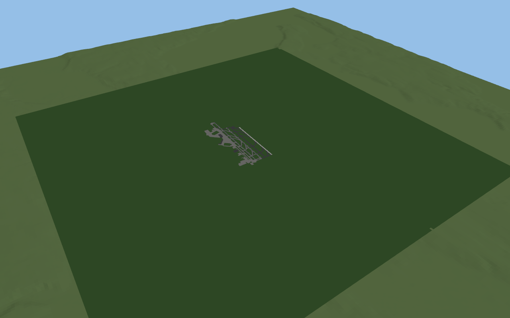

### Documentation

- Shortened the README to the project overview, download, quick start and documentation links.
  Moved detailed compatibility tables and the generated roadmap to `docs/COMPATIBILITY.md`,
  and preserved earlier command examples and development notes in `docs/DEVELOPMENT_NOTES.md`.
  The compatibility generator now keeps the README summary compact.

### Live aircraft animation

- `fly` and `fly-render` now reevaluate cached OBJ8 animations from supported model
  controls and gear state each frame. Geometry, normals and visibility update while
  GPU vertex capacity stays fixed. Propeller/RPM, tire spin and plugin values remain
  unresolved; this is not verified original animation parity.
  `controls-render` exports four poses with the same model position and camera.
  [Evidence, supported bindings and limits](research/LIVE_OBJ_ANIMATION.md).
  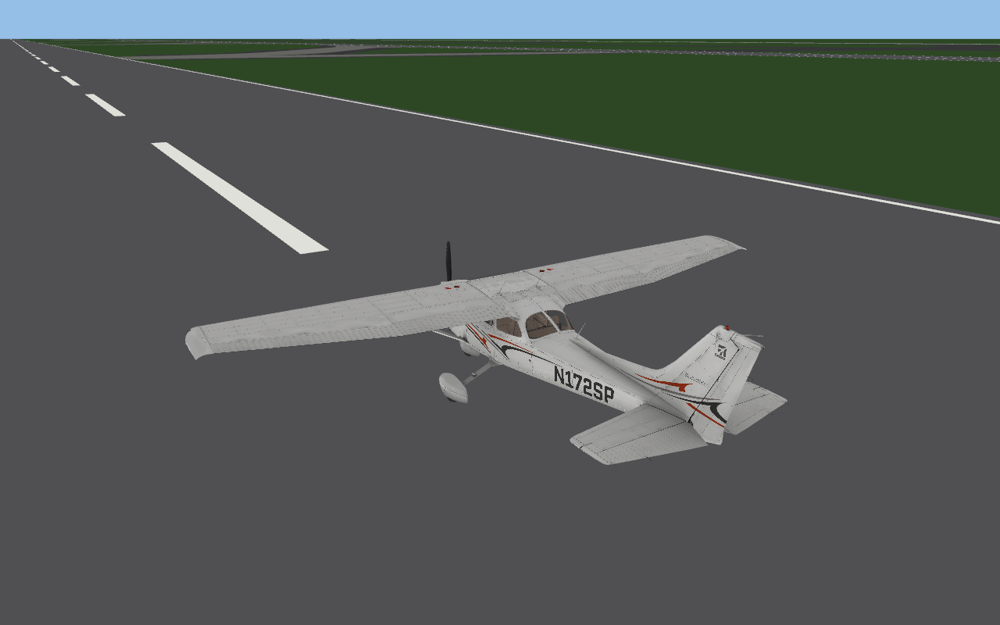

### Attachment rotations

- Aircraft previews now apply nonzero unattached object rotations to geometry and
  normals using the recovered original affine builder. Parent-part transforms remain
  unsupported.128 native matrix cases and an end-to-end rotated scene test pass.
  [Evidence and limits](research/ATTACHMENT_MATRIX.md).
  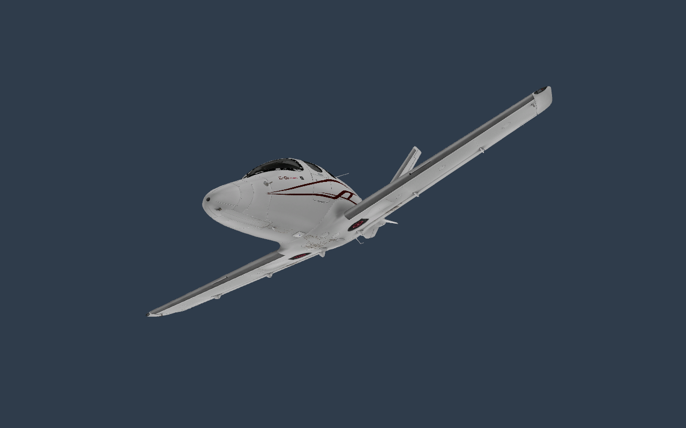

### ACF-driven aircraft previews

- Progress totals now show one decimal place. The evidence-backed rubric review
  updates the weighted estimates to41.7% implemented /28.3% verified; this remains
  a self-assessment, not a measurement of game readiness or visual parity.

- Aircraft previews now enumerate ACF object records instead of seven fixed Cessna
  filenames, apply the recovered preliminary draw gate and load attachment translations.
  The installed Cirrus SF50 now renders. Final visibility, materials, rotation and
  parent-part transforms remain incomplete; these are port renders, not parity pairs.
  [Native checks and runtime limits](research/OBJECT_DRAW_GATE.md).
  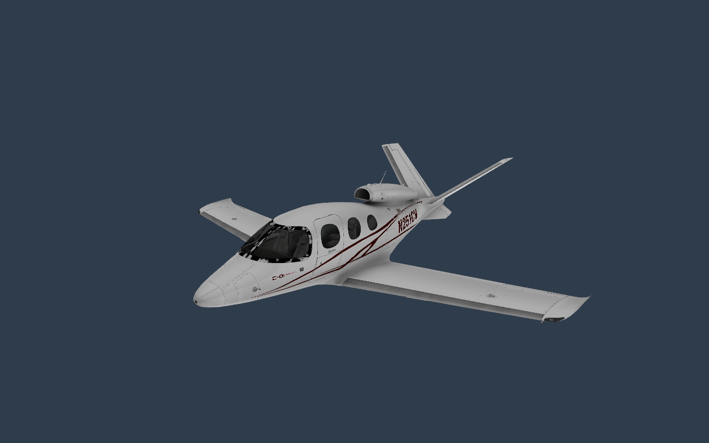
  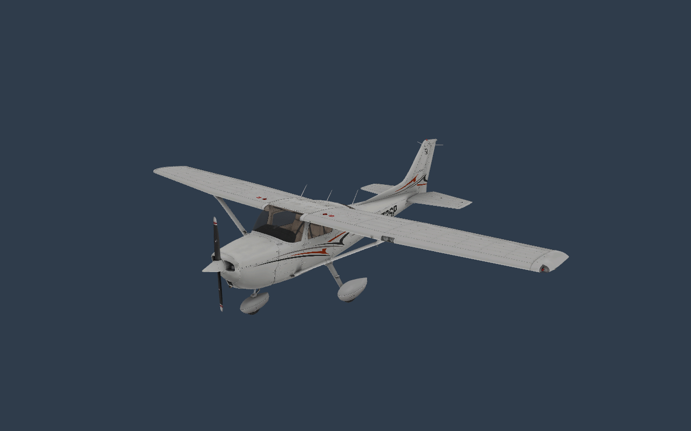

### Aircraft attachments

- Recovered common ACF object-attachment reads, coordinate scaling and CG subtraction,
  and legacy part-index migration against the original machine code. `aircraft-info`
  now reports attachment loader coordinates and indices. The renderer still uses its
  Cessna subset; visibility and final attachment transforms remain incomplete.
  [Evidence and limits](research/OBJECT_ATTACHMENTS.md).

### Installed scenery compatibility

- Offscreen flight exports no longer display fixed frame-rate/CPU/GPU values
  copied from a reference photograph. Unmeasured line0 is omitted; other selected
  data rows still show the current approximate flight model.
  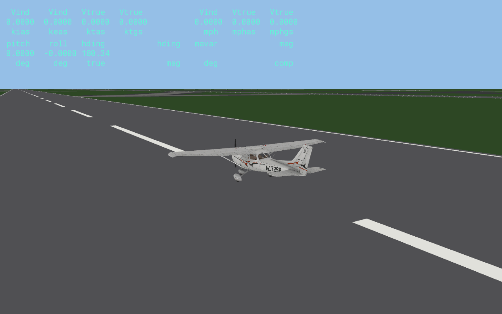

- Airport loading now accepts the existing typed apt.dat subset from versions
  1000/1050/1100/1130 as well as1200. Mixed older custom packs no longer abort
  lookup before a modern Global Airports entry. Confirmed by loading KSEA and
  rendering the stock Cessna from the installed reference content.
  [Evidence and limits](research/INSTALLED_RUNTIME_BASELINE.md).
  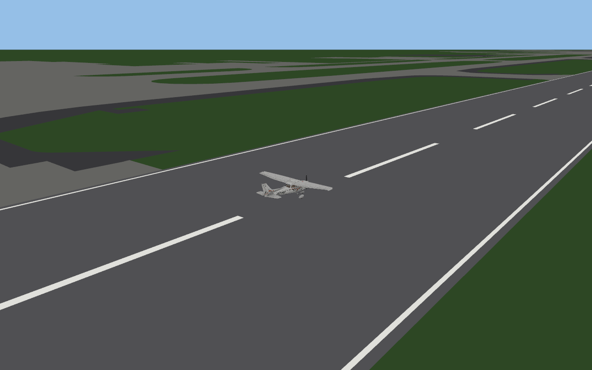

### Flight model

- Ported the original 49-pass wing grouping scan and connected its aspect/centroid
  parameters to the live model. 125 original-scan cases match membership, endpoints,
  accumulated area and reference fields exactly; all five local flight checks pass.
  [Evidence and limits](research/WING_GROUP_SCAN.md).

- Ported the original wing enabled and endpoint-join predicates: 2072 and 5872
  boolean results match exactly. ACF loading now applies the metre-space 1 mm gate
  and supports zero-root, positive-tip wings.
  [Evidence and limits](research/WING_GROUP_PREDICATES.md).

- Recovered original wing leading/trailing-edge point emission for aircraft bounds;
  512 original-code cases match every emitted coordinate exactly, including last-boundary
  interpolation rounding. [Evidence and limits](research/AIRCRAFT_REFERENCE_BOUNDS.md).

- Recovered grouped-wing aspect and shape writers. The shape parameter comes from a
  discretized area centroid, rather than raw chord taper. 635 original-code cases
  compare 4445 arithmetic outputs exactly with recorded CRT cosines.
  [Evidence and limits](research/WING_GROUP_DIMENSIONS.md).

- Recovered aircraft reference bounds and sizes from the original writer: origin-inclusive
  bounds and 1% padded absolute extents. 1013 original-code cases compare all ten
  words exactly. [Evidence and limits](research/AIRCRAFT_REFERENCE_BOUNDS.md).

- Interactive flight now uses the recovered delta coefficient branch for swept wings,
  with AFL thickness, model time and its existing noise table. Five local Cessna
  behavioural checks pass, including a 60-degree swept-wing smoke case. Runtime
  reference fields remain approximate. [Evidence and limits](research/DELTA_WING_LIVE.md).

- Connected explicit delta state through the complete element force API.
  200 original full-function cases validate controls, force scaling and delta integration;
  corrected alternative-panel atan rounding exposed by a nearly cancelling moment.
  [Evidence and limits](research/DELTA_WING_FORCE.md).

- Added explicit delta runtime context to the complete wing-element evaluator.
  350 original whole-function cases verify 508 profile calls, the blend, stall,
  induced drag and ice ordering; 2099/2100 output words match exactly on macOS.
  [Evidence and limits](research/DELTA_WING_INTEGRATION.md).

- Ported the complete delta-wing target coefficient construction, including both
  noise factors and their intermediate rounding. All 7584 coefficient words match
  original-code replay with recorded CRT results; platform trigonometry is checked
  separately. [Evidence and limits](research/DELTA_WING_TARGET.md).

- Ported the six-octave two-dimensional noise used by delta-wing modulation;
  1756 original-code cases compare exactly with an explicit synthetic table.
  [Evidence and limits](research/NOISE2_EXACT.md).

- Ported the three initial delta-wing parameter curves; local double power rounding corrects five
  one-ULP differences. 2027 original-code cases compare 6081 words exactly in debug and release.
  [Evidence and limits](research/DELTA_WING_PARAMETERS.md).

- Ported the final bounded delta-wing Cl/Cd/Cm/ratio blend and its stall flag: 2228 original-code
  cases compare five outputs exactly in debug and release. The preceding delta coefficient/noise
  construction is still pending. [Evidence and limits](research/DELTA_WING_BLEND.md).

- Extracted the original profile weight stage used by the full wing evaluator and preserve its +0 ramp
  result in optimized builds; 2440 original-code cases compare all three weights exactly.
  Original-code emulation now rejects incomplete execution instead of accepting stale registers.
  [Evidence and limits](research/WING_SPAN_EXACT.md).

- Delta-wing weight now evaluates tangent in double precision and rounds once to float32, correcting
  a 3-ULP mismatch exposed by an expanded original-code corpus. New strict geometry checks compare
  4062 cases / 8124 outputs bit for bit in debug and release on the tested macOS host.
  [Evidence and limits](research/WING_GEOMETRY_EXACT.md).

- Every engine kind of the reference build is ported and runs inside the engine controls: electric, carburetted and
  injected piston (the Cessna 172 SP), free and fixed turboprop, with the starter, the thrust term and the propeller
  power curve. The flight step is ported block by block: the wing and body loops, the airflow wash with the body
  shadow, the part drag, the equations of motion with the velocity and rate integration, the position setter, the
  attitude quaternion, the aircraft-axes velocities, the geographic state and the flight angles, and now the whole
  ground contact chain: the landing gear and steering, the wing strip and body surface probes, the body contact
  response, the ground side force and the gear drag with the brake energy. Each is compared with the original
  machine code in an emulator. The terrain mesh probes (vertical ray and segment with moving cells and surface
  roughness), the strut and tire contact, the weight and balance sums and the input binding query are ported too,
  and the contact blocks now run them natively instead of replaying them.
  The wheel contact model and the body surface blend contact are ported whole, together with the wind sampler
  (rotating gust, two turbulence scales, storm cell), the grid terrain height, the gear lever step and the engine
  ratio, blend and limit queries; the engine controls now run the engine update of the jet and rocket kinds and apply
  its thrust force to the flight object. Running the update on whole objects fixed the power input of one engine
  term.

### Datarefs

- 2388 datarefs are mapped to the field of the flight object (or the global simulation object) that the original's getter reads, with the unit factor and writability (`research/FLIGHT_DATAREFS.md`, `research/FLIGHT_FIELDS.md`).

### Viewer and scenes

- The Cessna 172 SP exterior (OBJ8 with textures, lighting and glass) and airports from apt.dat.

- The data-output lines of the reference build, drawn in its layout.

### Everything else in 0.1

- The data-output lines of the reference build (`OPENXPLANE_DATA_OUTPUT`, frame rate, speeds, attitude, position and others) and the label table of all 173 data-output lines extracted from the executable. The earlier invented instrument panel, key help and menu bar are removed.
- Ports with emulator vectors: the element planform area, the control surface deflection getter, the control surface terms function and two small helpers.
- Workspace of crates by subsystem (`xp-acf`, `xp-airfoil`, `xp-obj`, `xp-scenery`, `xp-dataref`, `xp-sim`,
  `xp-discord`, `xp-app`), with scripts, CI and nightly builds.
- Readers for ACF, OBJ8, AFL and apt.dat; the standard X-Plane folder layout and its precedence.
- The airfoil evaluation chain, the profile function and the straight-wing path of the wing element function,
  verified bit for bit against the original machine code in an emulator.
- Registries and catalogs of 5503 datarefs and 3012 commands, and the original's default keyboard map.
- An approximate flight model on the Cessna's real data, an airport ground scene from apt.dat, a chase-camera
  viewer (`fly`) and frame renderer (`fly-render`).
- Discord Rich Presence, the project website and the research notes.
