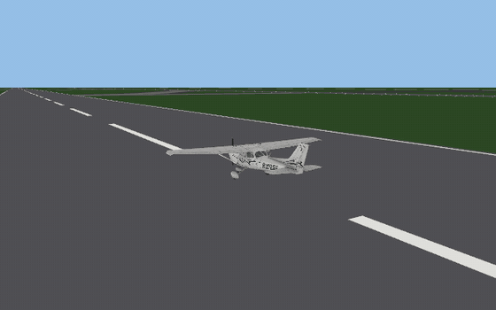
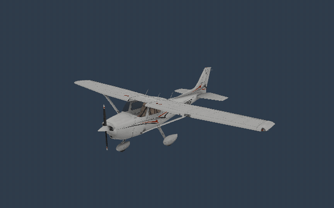
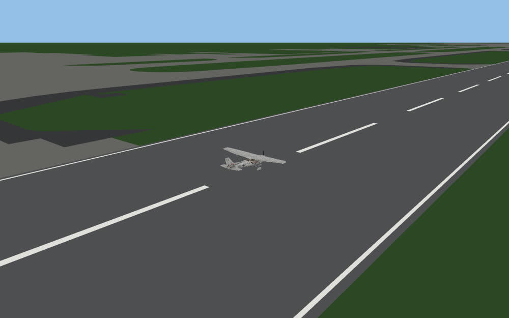
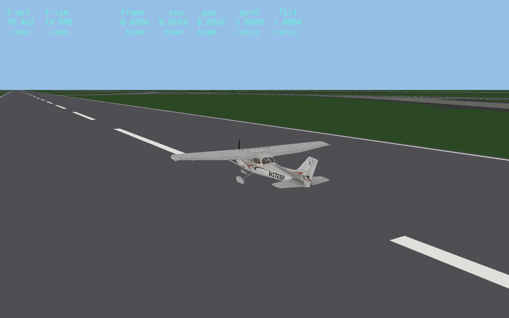

# Changelog

All notable changes. The newest is first. Versions are `MAJOR.MINOR.COMMITS` (see `scripts/version.sh`).

Every entry that changes what you can see carries a screenshot or an animation (pictures live in
`site/assets/`; the website strips the `site/` prefix).

## 0.1

### Flight model

- Connected explicit delta state through the complete element force API.
  200 original full-function cases validate controls, force scaling and delta integration;
  corrected alternative-panel atan rounding exposed by a nearly cancelling moment.
  [Evidence and limits](research/DELTA_WING_FORCE.md).

- Added explicit delta runtime context to the complete wing-element evaluator.
  350 original whole-function cases verify 508 profile calls, the blend, stall,
  induced drag and ice ordering; 2099/2100 output words match exactly on macOS.
  [Evidence and limits](research/DELTA_WING_INTEGRATION.md).

- Ported the complete delta-wing target coefficient construction, including both
  noise factors and their intermediate rounding. All 7584 coefficient words match
  original-code replay with recorded CRT results; platform trigonometry is checked
  separately. [Evidence and limits](research/DELTA_WING_TARGET.md).

- Ported the six-octave two-dimensional noise used by delta-wing modulation;
  1756 original-code cases compare exactly with an explicit synthetic table.
  [Evidence and limits](research/NOISE2_EXACT.md).

- Ported the three initial delta-wing parameter curves; local double power rounding corrects five
  one-ULP differences. 2027 original-code cases compare 6081 words exactly in debug and release.
  [Evidence and limits](research/DELTA_WING_PARAMETERS.md).

- Ported the final bounded delta-wing Cl/Cd/Cm/ratio blend and its stall flag: 2228 original-code
  cases compare five outputs exactly in debug and release. The preceding delta coefficient/noise
  construction is still pending. [Evidence and limits](research/DELTA_WING_BLEND.md).

- Extracted the original profile weight stage used by the full wing evaluator and preserve its +0 ramp
  result in optimized builds; 2440 original-code cases compare all three weights exactly.
  Original-code emulation now rejects incomplete execution instead of accepting stale registers.
  [Evidence and limits](research/WING_SPAN_EXACT.md).

- Delta-wing weight now evaluates tangent in double precision and rounds once to float32, correcting
  a 3-ULP mismatch exposed by an expanded original-code corpus. New strict geometry checks compare
  4062 cases / 8124 outputs bit for bit in debug and release on the tested macOS host.
  [Evidence and limits](research/WING_GEOMETRY_EXACT.md).

- Every engine kind of the reference build is ported and runs inside the engine controls: electric, carburetted and
  injected piston (the Cessna 172 SP), free and fixed turboprop, with the starter, the thrust term and the propeller
  power curve. The flight step is ported block by block: the wing and body loops, the airflow wash with the body
  shadow, the part drag, the equations of motion with the velocity and rate integration, the position setter, the
  attitude quaternion, the aircraft-axes velocities, the geographic state and the flight angles, and now the whole
  ground contact chain: the landing gear and steering, the wing strip and body surface probes, the body contact
  response, the ground side force and the gear drag with the brake energy. Each is compared with the original
  machine code in an emulator. The terrain mesh probes (vertical ray and segment with moving cells and surface
  roughness), the strut and tire contact, the weight and balance sums and the input binding query are ported too,
  and the contact blocks now run them natively instead of replaying them.
  The wheel contact model and the body surface blend contact are ported whole, together with the wind sampler
  (rotating gust, two turbulence scales, storm cell), the grid terrain height, the gear lever step and the engine
  ratio, blend and limit queries; the engine controls now run the engine update of the jet and rocket kinds and apply
  its thrust force to the flight object. Running the update on whole objects fixed the power input of one engine
  term.

### Datarefs

- 2388 datarefs are mapped to the field of the flight object (or the global simulation object) that the original's getter reads, with the unit factor and writability (`research/FLIGHT_DATAREFS.md`, `research/FLIGHT_FIELDS.md`).

### Viewer and scenes

- The Cessna 172 SP exterior (OBJ8 with textures, lighting and glass) and airports from apt.dat.

- The data-output lines of the reference build, drawn in its layout.

### Everything else in 0.1

- The data-output lines of the reference build (`OPENXPLANE_DATA_OUTPUT`, frame rate, speeds, attitude, position and others) and the label table of all 173 data-output lines extracted from the executable. The earlier invented instrument panel, key help and menu bar are removed.
- Ports with emulator vectors: the element planform area, the control surface deflection getter, the control surface terms function and two small helpers.
- Workspace of crates by subsystem (`xp-acf`, `xp-airfoil`, `xp-obj`, `xp-scenery`, `xp-dataref`, `xp-sim`,
  `xp-discord`, `xp-app`), with scripts, CI and nightly builds.
- Readers for ACF, OBJ8, AFL and apt.dat; the standard X-Plane folder layout and its precedence.
- The airfoil evaluation chain, the profile function and the straight-wing path of the wing element function,
  verified bit for bit against the original machine code in an emulator.
- Registries and catalogs of 5503 datarefs and 3012 commands, and the original's default keyboard map.
- An approximate flight model on the Cessna's real data, an airport ground scene from apt.dat, a chase-camera
  viewer (`fly`) and frame renderer (`fly-render`).
- Discord Rich Presence, the project website and the research notes.
