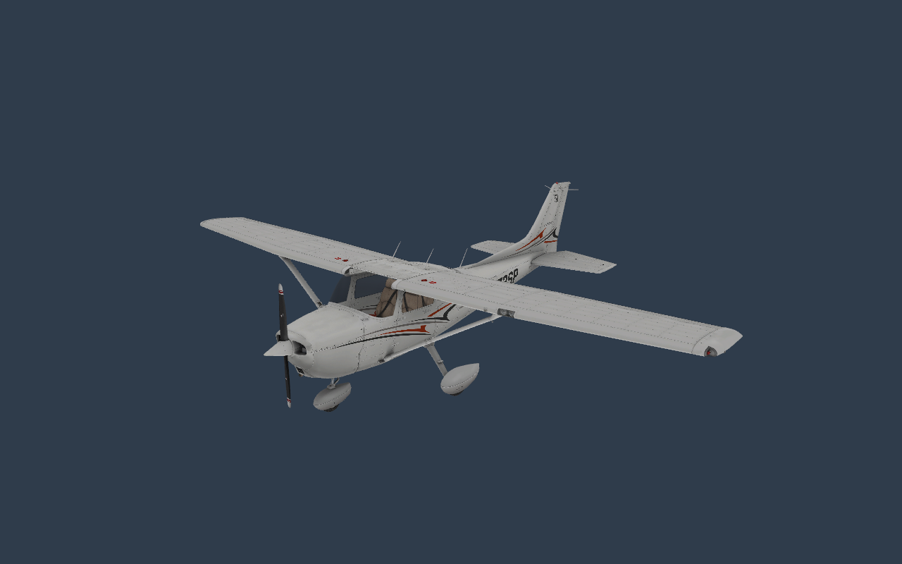

<p align="center">
  <picture>
    <source media="(prefers-color-scheme: dark)" srcset="assets/logos/wordmark-light.svg">
    
  </picture>
</p>

**openXplane** is an independent open engine with gradual compatibility with X-Plane content, written in Rust.
Approach: study the original, implement each subsystem independently, and compare the results with the
reference build. The first reference is a provided X-Plane 12.

> [!IMPORTANT]
> openXplane contains no game content. It needs an original copy of X-Plane 12 and only reads from it.



## Download

Every change to `main` is built by GitHub Actions and published as the rolling
[nightly release](https://github.com/OpenXPlane/openXplane/releases/tag/nightly):

| Platform | File |
| --- | --- |
| Windows x64 | `openXplane-<version>-windows-x64.zip`, run `openxplane.exe` |
| macOS (Apple silicon) | `openXplane-<version>-macos-arm64.zip`, run `openxplane` |
| Linux x64 | `openXplane-<version>-linux-x64.zip`, run `openxplane` |

There is no launcher yet: run it from a terminal and point it at your X-Plane 12 folder (see the [user guide](docs/USER_GUIDE.md)).

## Quick start

After unpacking the archive, run this from a terminal, replacing `<X-Plane>` with your installation path:

```sh
openxplane fly "<X-Plane>" KSEA "<X-Plane>/Aircraft/Laminar Research/Cessna 172 SP/Cessna_172SP.acf"
```

See the [user guide](docs/USER_GUIDE.md) for aircraft viewing, airport scenes and controls.

<!-- compat:start -->
## Project status

The goal is a complete game with 1:1 X-Plane 12 behaviour. The current engine loads original
content, renders aircraft and airports, and flies an approximate flight model.

Compatibility with unmodified original mods is mandatory: aircraft, liveries,
scenery, libraries, scripts and native plugins. Full mod support is not yet
implemented or verified. See the [mod acceptance requirements](docs/GOAL.md#original-mod-compatibility-is-mandatory).

**About 43.8% implemented and 28.3% verified identical**, according to a self-assessed
weighted rubric, not a measurement of whole-game equivalence. See the
[compatibility estimate and roadmap](docs/COMPATIBILITY.md) for evidence and limitations.
<!-- compat:end -->

## Documentation

[Project website](https://openxplane.github.io/openXplane/) · [Documentation site](https://openxplane.github.io/openXplane/docs/)

- [User guide](docs/USER_GUIDE.md), [keyboard controls](docs/KEYBOARD.md) and [FAQ](docs/FAQ.md)
- [Building](docs/BUILDING.md), [contributing](CONTRIBUTING.md) and [releasing](docs/RELEASING.md)
- [Architecture](docs/ARCHITECTURE.md), [implementation plan](docs/PLAN.md) and [compatibility](docs/COMPATIBILITY.md)
- [Research and verification](research/VERIFICATION.md), [research notes](research/) and [changelog](CHANGELOG.md)
- [Earlier development notes, repository layout and command examples](docs/DEVELOPMENT_NOTES.md)

Security issues: [SECURITY.md](SECURITY.md).

## License

GPL-3.0-or-later, see [LICENSE](LICENSE) and [NOTICE](NOTICE). X-Plane is a trademark of its respective owner. openXplane is an independent
project and is not affiliated with it.
