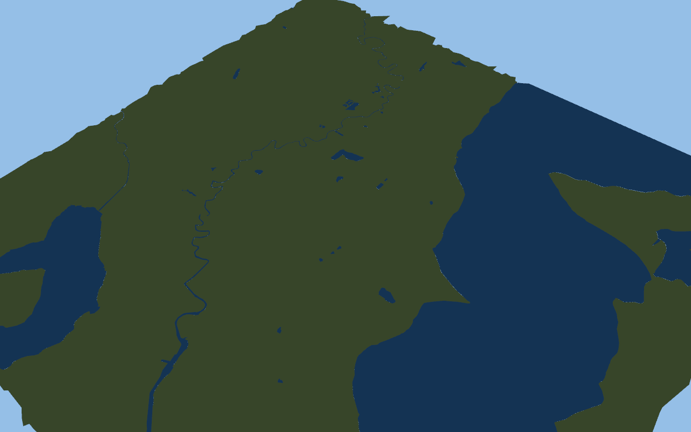

# Source DSF terrain topology

The 2026-10-26 terrain decoder reads the installed compressed global DSF using
the same bounded in-memory archive reader as the elevation raster. It retains
terrain definitions, patch flags and near/far LOD, plus all scaled point planes.
Triangle lists, strips and fans support explicit, cross-pool and range forms
(commands23..31). Patch16 inherits flags/LOD;17 changes flags;18 changes both.
The terrain definition is captured at patch creation, not each primitive.

This follows the [public DSF format](https://developer.x-plane.com/article/dsf-file-format-specification/),
not a recovered native geometry loader. Strip parity alternates winding; fans
retain their first vertex. Extraction bounds select intersecting triangle AABBs,
without clipping or retessellating source triangles. Definition, pool/index,
finite point/LOD and primitive-count checks reject malformed inputs. Bounds must
be finite and ordered. Compressed CRCs are checked; the DSF footer MD5 is not.

```sh
openxplane mesh-render "<X-Plane>" KSEA mesh.png
```

The actual KSEA run reads global tile+47-123. Bounds extend0.15 degrees east/west
and0.1 degrees north/south of the airport datum. It retains39303 triangles:
28595 physical,10708 overlay, using78 terrain definitions. The RTX2080/Vulkan
image renders the source coastline and inland water geometry, not the earlier
regular100m grid. There is no artificial central slab in this inspection scene.



Elevation uses the DSF point unless it requests raster elevation(-32768) or is
terrain_Water; those points sample the elevation raster. This follows the
[published DSF usage](https://developer.x-plane.com/article/dsf-usage-in-x-plane/).
Explicit X/Z normals derive Y; zero normals use geometric triangle normals.
Interpolation, raster sampling and local spherical projection remain port
approximations; original geometry/normal generation is unverified.

The inspection deliberately uses diagnostic land/water colors, all patch LODs,
and the existing renderer without proper overlay depth/material rules. It does
not claim source terrain shaders, vegetation or water effects. This scene has
no airport or aircraft; the existing airport/fly commands still use the older
raster/slab preview. Do not describe this as replacement of the playable world's
terrain. Required next work: interpret TER resources/UVs, drape airport/scenery
surfaces and connect the physical patch triangles to wheel/collision height,
then replace the preview in the live scene and compare with the original.

Synthetic checks exercise all nine primitive forms, strip winding, cross-pool
points, list counts, patch definition capture/inherited flags/LOD, bounds filtering
and invalid indices/ranges. Workspace fmt, Clippy and ordinary tests check the
port; ignored native replay tests are separate. No paired original capture or
native geometry replay has established equivalence.

Scenery implementation estimate17% to18% for source terrain topology and its
installed-file GPU inspection. This is a planning judgement, not a test-derived
completion fraction. Verified scenery remains0%; full map, physics and original
mod compatibility are incomplete. No original source/assets are redistributed.
