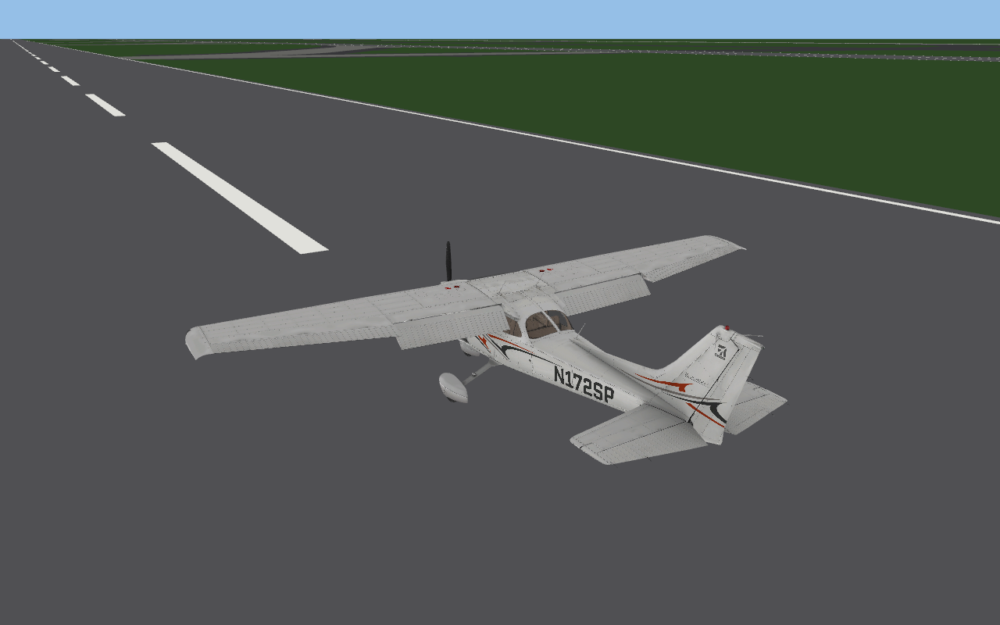

# Live OBJ animation in the flight scene

OBJ byte loading now strips comment bytes before UTF-8 decoding. This preserves
valid resource names and rejects invalid bytes outside comments. The installed
ruscenery `fuel-tank3.obj` contains non-UTF-8 bytes only in two comments; its
geometry and declared texture now load. The subsequent UHWW preview reports
1193 nearby instances, zero failed resources and 652 unresolved placements in
the main custom overlay. This is a content-loading observation, not original
encoding or rendering parity. The [capture](../site/assets/uhww-legacy-comments.jpg)
has no matched original frame.

`ANIM_keyframe_loop` wraps the resolved finite dataref value by its nonzero period
before interpolation; zero disables wrapping in the preview. This follows the
published OBJ8 remainder description; negative values, zero-period behavior and
native runtime evaluation have not been compared against the original.
REA identified a loader branch at `0x1408784b6..0x1408784d8` that converts the
read double to float and stores it at the current animation record's `+0x14`.
`tools/probe_obj_animation_loop.py` checks five supplied numbers through this
block with the numeric reader substituted. This tests storage, not evaluation.
Some installed UHWW OBJ files omit key-table end commands and put the loop
command inside the unfinished block. Original code at `0x140878267..0x14087827c`
creates the translation record at the begin directive; the loop branch updates
the most recent animation record without checking whether the key-table end was
seen. The preview accepts a loop after a nonempty key table by committing that
table, and supports looping visibility. This is a bounded compatibility policy:
late key directives and full original parser/evaluator behavior are unverified.
The installed `Rigolan_CargaCinta_Animated.obj` now parses and evaluates, but
its animated visual appearance has not been matched against the simulator.
The installed UHWW preview subsequently loaded the previously rejected models;
its first overlay reported one failed resource rather than four. A zero loop
period disables wrapping in the preview, while the original runtime's handling
of that value remains unverified.
The [UHWW capture](../site/assets/uhww-animation-compat.jpg) is an initial-state
preview; scenery object animation is baked there, and no matched reference capture
or motion comparison is available.

## Behavior and evidence boundaries

OBJ parsing previously consumed animation commands at dataref value zero and kept
only baked draws. The flight scene now retains typed animation operations and
reevaluates them from the current model controls/state for every rendered frame.
Nested translation/rotation, keyed interpolation/extrapolation and ordered
show/hide commands follow the [official OBJ8 specification](https://developer.x-plane.com/article/obj8-file-format-specification/).
Existing static-zero parsing behavior is retained. This adds runtime integration;
it is not a claim of identical original animation execution or registry behavior.

REA rechecked original key insertion at `0x1408751b0..0x1408752b0` in the unchanged
reference PE (X-Plane 12.4.3-r2, build 124311, SHA-256
`2ca099b7c6b218e78d02bdbe298be2aebf670b67c5adff827449b065e1107936`).
Local Evidence ID:
`ev_157b01a71658c9f1825301ef40b6fd64d87c42492c7fa32c26f769adb51f3fb3`.
The bounded adapter selector is `obj-key-insert`. The branch performs lower-bound
insertion and replaces an equal key's value. The native sequence uses double
key/value words; this port still retains float32 parsed keys. Ordering/replacement
is supported, but full precision and native runtime interpolation are not verified.
No disassembly or original assets are distributed.

## What is connected

`FlightModel::animation_dataref` is an explicit adapter for the existing approximate
flight model, not a recovered original dataref accessor. It exposes:

- Aileron/elevator/rudder/flap deflections for the original wing index, using the
  same control limits, trim, side and flap-detent calculation as the force model.
- Elevator trim and the single modeled engine's throttle ratio.
- Tire compression and steering for the original ACF gear slot. Inactive slots may
  be omitted from the contact vector, so each stored gear now retains its ACF index.

RPM, propeller angle/disc state, tire spin, plugin values and unmodeled datarefs
remain unresolved and use zero in this viewer path. The resolver also treats
non-finite supplied values as zero; this is a viewer fallback, not recovered
original error handling. Keyframe loops, later LODs, materials and other commands
already reported unsupported remain outside the implemented subset.

The parsed operations are reused without reading/parsing OBJ files every frame.
Hidden triangle batches occupy degenerate vertex slots. Show/hide can therefore
change visibility while retaining the vertex count allocated by the GPU. Vertex
positions and normals pass through OBJ animations, the native-checked attachment
affine transform and the model's world transform. Glass sorting centers update with
the animated mesh. Live `fly` and offscreen `fly-render` use the same path.

Static `view`, `render` and `airport-view` do not run an interactive model clock;
plain aircraft previews retain zero-dataref baking. The airport scene prepares the
runtime animation cache and initial model pose, then remains static until stepped.

## Executed checks and captures

- All eight xp-obj unit tests pass, including nested scope restoration, rotation
  and normals, keyed extrapolation, duplicate-key replacement and constant vertex
  capacity across hide/show transitions. Existing six static tests remain green.
- A reference-content test explicitly loads the installed Cessna and checks opposite
  aileron signs, flap deflection, trim, unresolved prop angle and non-compacted gear
  slot lookup. This is an approximate-model integration test, not an original-code
  comparison. Other local flight tests keep their existing opt-in/skip behavior.
- Workspace formatting, Clippy with warnings denied and the full workspace suite pass.
- `controls-render` uses the installed Cessna/KSEA and actual runtime animation path
  to export four fixed control poses at identical world position and camera. No
  physics time advances between them. These are controlled pose captures, not an
  original/port pair or a continuous live-session recording. GPU: RTX2080/Vulkan.

```sh
openxplane controls-render "<X-Plane>" KSEA "<X-Plane>/Aircraft/Laminar Research/Cessna 172 SP/Cessna_172SP.acf" site/assets/cessna-controls-20261026
```

The exports are `-neutral.png`, `-flaps-down.png`, `-roll-left.png` and
`-roll-right.png`. Controls are neutral, full flap handle, then opposing 0.8 aileron
and 0.5 rudder inputs with opposing 0.3 elevator inputs. Engine throttle remains zero.
No reference-installation files are modified.

The five-frame GIF below cycles neutral, full flaps, left/right controls and
neutral again. It is encoded from the exported PNGs with ffmpeg, with no synthesized
intermediate poses. It is a pose sequence, not a real-time performance recording.
All frames are 1280x800; the GIF is 134238 bytes. Against neutral, full flaps change 8917
pixels, left controls 16493 and right controls 17724; differences remain in the aircraft
region. The static zero-dataref Cirrus render also remains pixel-identical to its
previous baseline after the parser refactor.




## Remaining work and rubric review

Recover and compare the original runtime animation evaluator and binding lifecycle;
connect the general registry and plugin values; add actual RPM/propeller/wheel state,
parent-part motion, loop behavior and full materials. Original Alt/Esc UI and matched
visual/motion comparison still remain required by the full-game goal.

The OBJ8 implementation rubric moves 35% to 40% for cached dataref-driven animation,
and rendering 23% to 26% for integration through the moving scene and GPU. Verified
shares do not increase: standards-based evaluation and approximate model bindings
are not newly verified original behavior. Weighted estimates become 42.28%/28.33%,
displayed 42.3%/28.3%. These are coverage judgements, not case-count measurements.
