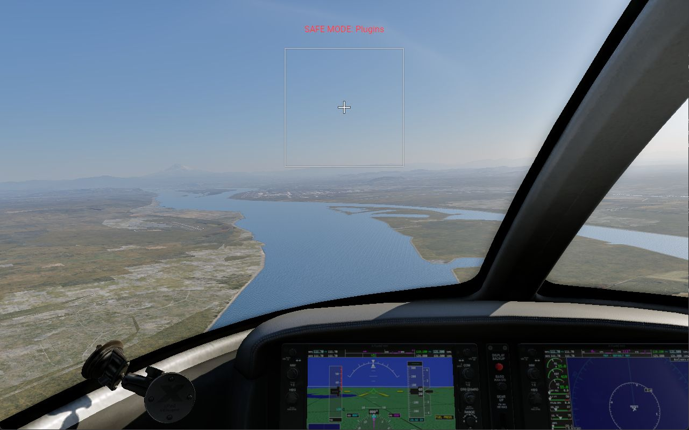
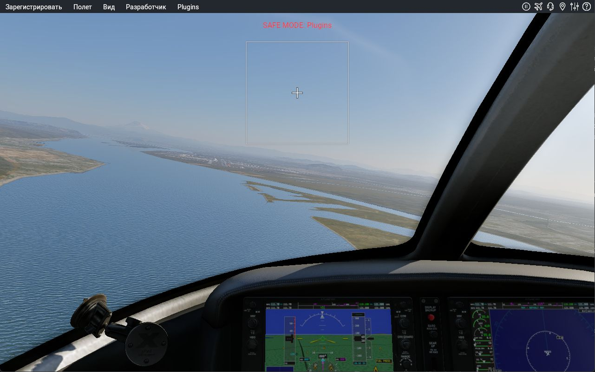

# New original window captures, 2026-10-26

The Computer Use JavaScript kernel was reset after the earlier kernel-assets
path failure, then `@oai/sky` initialized successfully. A unique returned
X-Plane window was selected from `list_windows`; capture became valid after
activating that window. The first occluded capture showed a different foreground
application and was discarded, not used as reference evidence.

## Captured original



This is a new capture from the installed reference, not a gallery asset or a
generated image. It shows the stock Cirrus cockpit and Portland-area replay.
The window capture is1281x801 JPEG despite the requested1280x800 window. It is
lossy capture evidence; it is not a lossless pixel reference for font/material
measurement. The stored bytes are unchanged; no retouching or cropping was used.
The earlier frame with a Steam notification is local only.

The run uses the installed FPS replay, low preset1, `--safe_mode=PLG`, sound
and joysticks disabled, network disabled. The visible overlay says SAFE MODE:
Plugins. The log nevertheless records aircraft XLua loading; do not assert that
every plugin or script was excluded. Replay, simulation time, camera projection,
weather/exposure, DPI and UI scale still require complete matched metadata.
See [the executable identity and FPS evidence](REFERENCE_FPS_CAPTURE.md).



The first accepted flight capture has no top bar. A subsequent observed Escape
input was followed by the displayed Russian top bar (Registration, Flight, View,
Developer, Plugins and right-side icons). A following Alt input retained the bar;
a click on Flight did not produce a visible dropdown in the refreshed capture.
The replay continued moving. These point observations are specific to this
automated FPS mode: they do not prove ordinary interactive Alt/Esc transitions,
mouse hit-testing, paused state or a complete menu sequence. Mouse position,
auto-hide timing and benchmark input suppression are not isolated.

Current openXplane exits on Esc and uses its own HUD. Its new KSEA/Cessna frames
are a different aircraft, location, camera and resolution; these original frames
must not be used as a same-scene pixel comparison. The visible native cockpit,
water/terrain/material detail and menu bar remain absent or approximate in the
port. UI/graphics verified shares stay unchanged at zero.

## Native QA capture plan

The public [Laminar FPS documentation](https://www.x-plane.com/kb/frame-rate-test/)
describes `--qa_script`, WAIT, CMND and NEXT_FRAME. The local Commands.txt
contains `sim/operation/screenshot`. `tools/make_reference_capture_plan.py`
creates a script and manifest with reference/replay/script hashes, explicit
arguments, requested window size and a pre-run Output image inventory. It does
not launch the simulator, change preferences or claim that a request succeeded.

```powershell
python tools/make_reference_capture_plan.py '<X-Plane>' '<new local evidence directory>'
```

Use the manifest's executable, working directory and argument array for launch.
Track the actual game rather than assuming a launcher exit means termination.
Do not launch a duplicate while the original is live. Capture files and full
logs stay local; publish only reviewed images and bounded research notes.

An actual QA run with a drive-qualified path (`E:/.../capture.qa`) failed with
the reference's bad-directory-character diagnostic at xmap.cpp:207. The corrected
generator uses a relative path from the game directory on the same drive. The
next run reached a visible replay window; native screenshot files have not yet
been confirmed. The window captures above came from Computer Use, not QA export
or a claimed response to Shift+Space. That keyboard request did not establish
an output file either.

## Next integration work

Use a controlled Cessna/KSEA startup and recorded matching camera/time to obtain
paired port/original frames and menu-motion captures. Recover object flag and
attachment behavior before replacing the port's hard-coded Cessna object list:
the Cirrus replay aircraft has different files and material/visibility flags.
Native loader141a96a0d..141a96b72 uses record stride120(hex), common
loader141aaa610, flags at record+88(hex) and the kill-dataref string at+98(hex).
Those static observations alone do not establish the renderer's flag meanings.
`_v10_is_internal` contains opaque historical values in supplied files and must
not be guessed into a Boolean visibility gate. Live whole-game integration and
the1:1 completion goal remain open.
