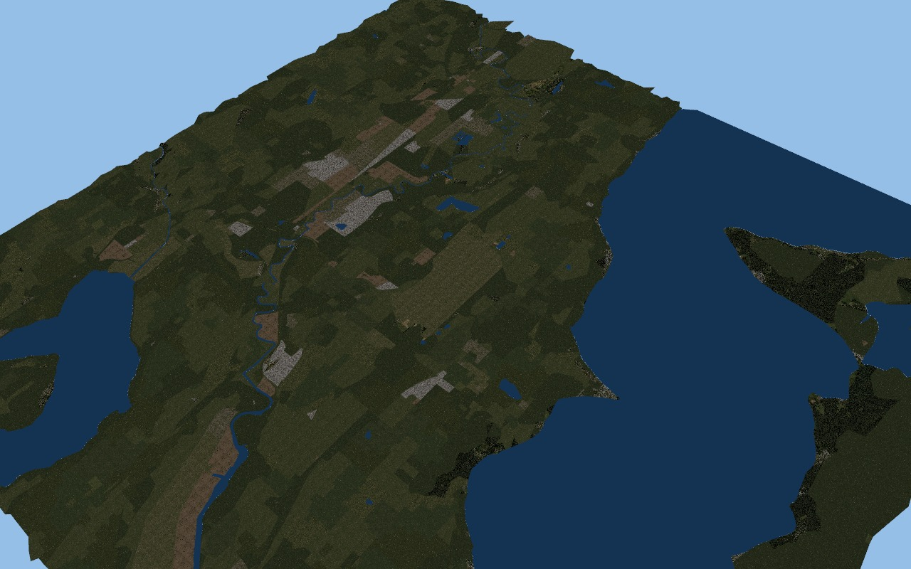

# GPU mipmap generation and minification

The 2026-10-26 renderer previously allocated one base-color mip level per scene
texture. It now allocates the complete chain down to1x1 and generates each level
from the previous one in a GPU render pass. Source and destination are distinct
single-level views of the same texture. The reduction uses linear sampling;
sRGB textures decode for sampling and encode when written to the sRGB target.
The camera/render material sampler uses linear mip filtering (trilinear
minification). Wrap/clamp behaviour still follows each existing material.
The HUD atlas retains its separate single-level texture.

This is our renderer's implementation, not recovery of the original simulator's
filtering. Original DDS mip payloads are still decoded to a base image by the
existing image loader; this change generates new levels rather than preserving
the author's supplied chain. Anisotropic filtering, native mip bias/quality,
alpha-test coverage preservation and exact premultiplied-alpha treatment remain
unverified or absent. Non-power-of-two reduction uses hardware bilinear resampling,
not exact area integration. Do not call the result original graphics parity.

For a controlled regression, OPENXPLANE_MIPMAPS=0 disables generation; the default
is enabled. Both captures use mesh-render, the same installed KSEA source mesh,
summer library context,1280x800 resolution and unchanged camera/material inputs.
The disabled run reports zero generated levels. This comparison isolates our
filtering change; neither image is an original reference capture.

Both RTX2080/Vulkan runs completed with39303 triangles and77 textured resource
batches. The enabled run reports793 generated mip levels; shader/texture/render
validation passed. Visual inspection shows substantially less fine-grained noise,
while missing terrain masks appear as harder patch boundaries. No temporal
shimmer or framerate improvement is claimed from these still images.




```sh
openxplane mesh-render "<X-Plane>" KSEA frame.png
```

The remaining hard texture boundaries are not solved by mipmaps: border/composite
terrain masks, normal/decal/night/weather/water shading and exact UV projection
are still missing. See TERRAIN_MATERIALS.md and LIVE_TERRAIN.md. Mipmap generation
adds texture storage and GPU initialization work; no measured performance claim
is made. Workspace fmt, Clippy and ordinary tests cover code regressions; actual
GPU execution additionally checks shader/pipeline/texture validation.

Coverage estimates are reviewed and unchanged. Better minification alone does
not prove native rendering, mod compatibility or whole-game completion.
